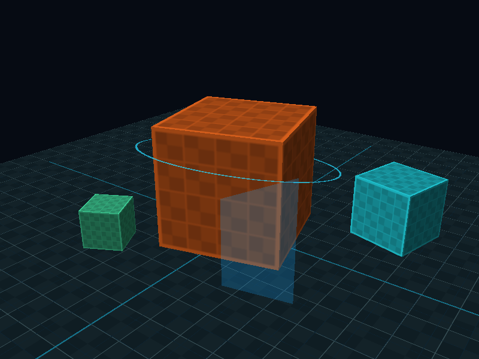

# HELO GPU

HELO 是一个从指令集开始设计的可编程 GPU 项目。它用同一个 SIMT 核心执行顶点、片元和计算程序。C++ 功能模型可以从显存中的命令包一路执行到帧缓冲，Verilog RTL 则逐个实现硬件单元，并通过差分测试与模型核对。



这张 800 × 600 的图来自整机测试。顶点 Shader 用矩阵变换顶点，片元 Shader 将插值颜色与采样得到的纹理颜色相乘，深度测试决定物体的遮挡关系。半透明圆环和玻璃面板使用同一条流水线混合到画面中。[场景源码](hw/verif/tests/gpu/gpu_test.cpp)

## 快速开始

在仓库根目录运行以下命令即可复现上图。需要 CMake 3.20 或更高版本、支持 C11 和 C++17 的编译器、Python 3，以及 PATH 中的 clang-format 18.1.8。

```sh
build_dir="build/demo_$(date +%Y%m%d_%H%M%S)"
cmake -S . -B "$build_dir" -DHELO_DUT=func -DCMAKE_BUILD_TYPE=Release
cmake --build "$build_dir" --config Release --parallel
ctest --test-dir "$build_dir" -C Release -R '^gpu_render_test_func$' --output-on-failure
```

生成的图片位于 `$build_dir/artifacts/gpu_scene.png`。要运行完整功能模型回归，去掉最后一行的 `-R '^gpu_render_test_func$'`。各项测试的命令、输出和退出码都保存在仓库根目录的 `logs/` 下。

## 实现进度

| 模块 | 当前能力 |
| --- | --- |
| 功能模型 · 图形 | 可编程顶点与片元 Shader、齐次裁剪、透视校正插值、多纹理与显式 LOD、深度与模板测试、4× MSAA、双颜色目标和 sRGB 输出 |
| 功能模型 · 计算 | 32 线程 warp、整数与 FP32 运算、分支和全局访存。较大的任务可分批执行，工作组可使用共享内存、原子加和跨 warp 屏障 |
| Verilog RTL | 单线程 Shader 核心可执行整数、控制流和访存指令。定点绘制路径可接收屏幕空间三角形，完成覆盖、插值、最近点纹理采样、深度测试和颜色混合写回 |
| 待实现 | RTL 命令处理器、几何前端、多线程 Shader 和整机连接。性能模型与主机驱动尚待实现 |

功能模型和 RTL 通过相同的输入比较可观察结果，包括寄存器、覆盖的像素以及写回的颜色和深度。RTL 回归使用 Verilator，另建构建目录并配置 `-DHELO_DUT=rtl`。[验证指南](docs/verification.md) · [RTL 实施进度](docs/rtl_graphics_plan.md)

## 阅读源码

- 想跟踪一次绘制，从命令处理器如何消费 `CLEAR`、`RENDER` 和 `COMPUTE` 开始。[GPU 顶层架构](docs/gpu.md) · [命令包格式](docs/cp.md) · [功能模型源码](hw/model/func_model/)
- 想编写 Shader，先看机器码编码、线程模型，以及顶点和片元阶段的寄存器约定。[HELO ISA](docs/isa.md) · [图形 Shader ABI](docs/graphics_abi.md)
- 想实现硬件单元，先对照现有模块和差分用例。覆盖规则、定点量化和舍入方式会直接影响像素结果。[RTL 源码](hw/rtl/) · [验证用例](hw/verif/tests/) · [图形数值约定](docs/numerics.md)

## 开发与贡献

HELO 采用 **vibe coding** 开发。开发者用自然语言描述架构与预期行为，AI 编程代理参与实现、编写测试和整理文档。指令语义、接口和数值规则记录在仓库中，贡献者可以据此复现问题、讨论设计并验证改动。[设计文档索引](docs/README.md)

报告渲染问题时，请附上复现命令、预期结果和实际图像。提交功能改动时，请同步更新相关设计文档，并附上对应的 CTest 结果。[项目协作约定](AGENTS.md) · [C++ 代码规范](docs/coding-style/cpp.md)

## 许可

仓库目前尚未声明项目整体许可证。功能模型使用的 Berkeley SoftFloat 保留其上游许可。[SoftFloat 来源与许可](docs/softfloat.md)
